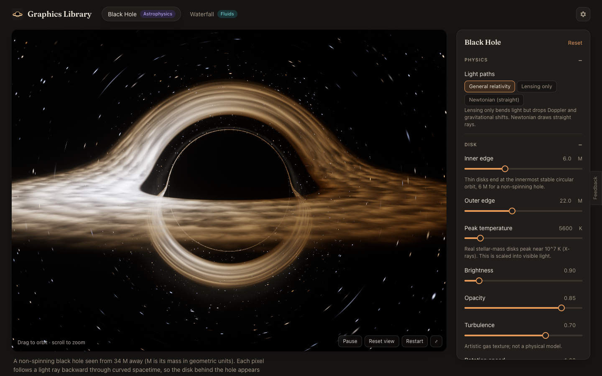
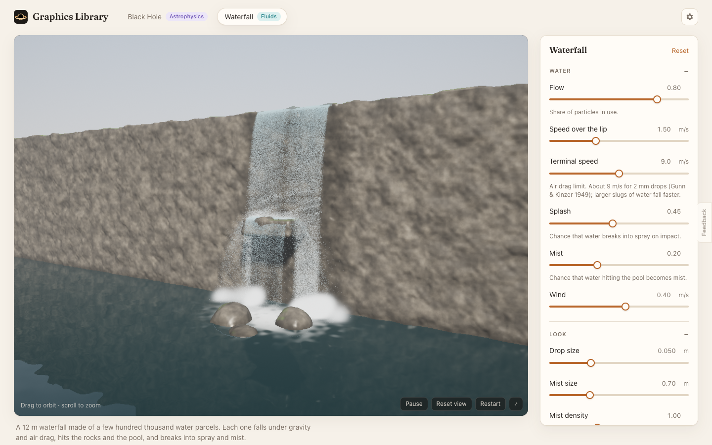
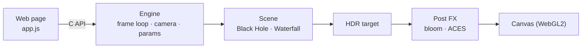

# Graphics Library

A C++ graphics library compiled to WebAssembly. It runs physically grounded simulations live in the browser, starting with a ray-traced black hole and a particle waterfall.

**[Open the live site →](https://amalmehta.github.io/GraphicsLibrary/)**

| | |
|---|---|
| [Instructions](docs/INSTRUCTIONS.md) | Build, run, use, and add a simulation |
| [System design](docs/SYSTEM-DESIGN.md) | Architecture, flows, physics, trade-offs, limits |
| [File structure](docs/FILE-STRUCTURE.md) | What's where |
| [Light mode](docs/images/blackhole-light.png) · [Dark waterfall](docs/images/waterfall-dark.png) | More screenshots |
