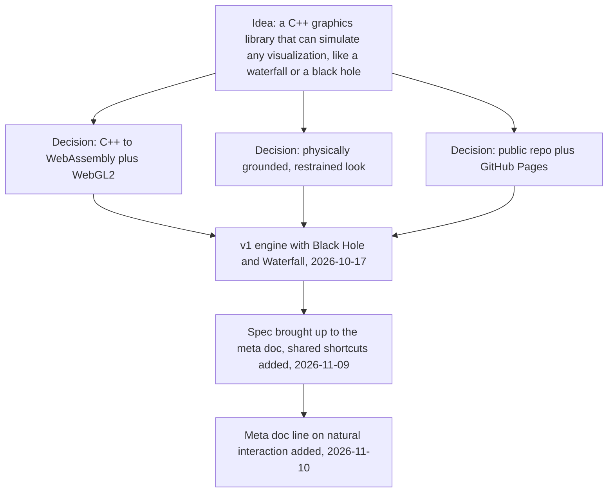
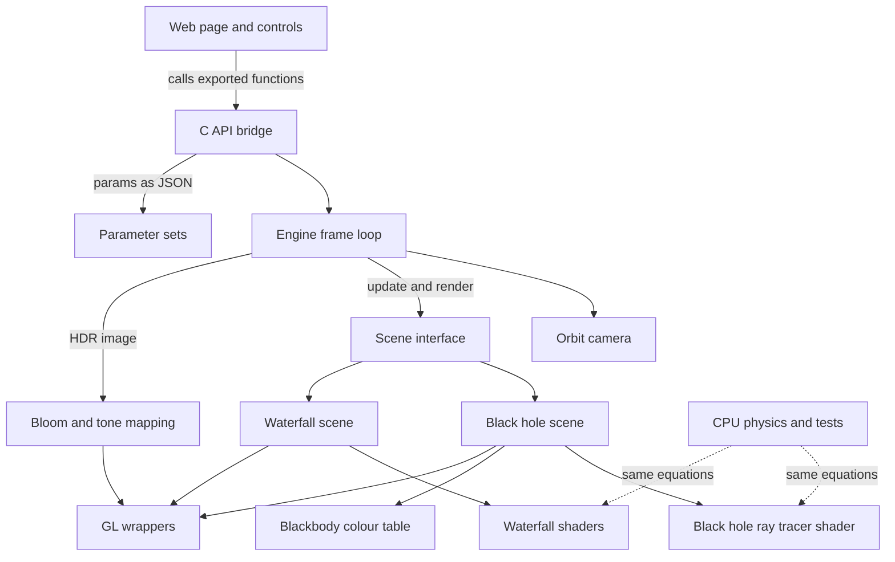
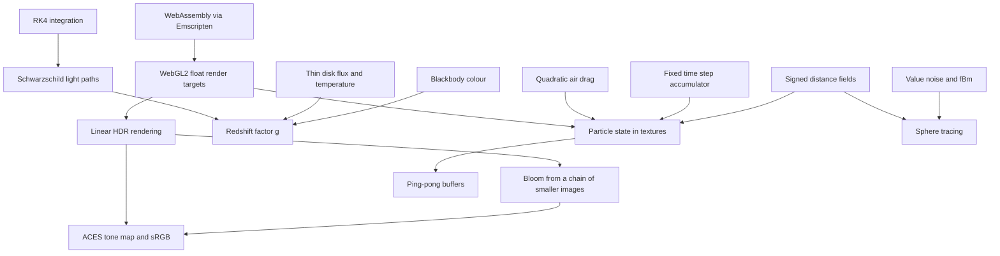

<!-- ProjectForge explainer at 49f8e8b -->
# How GraphicsLibrary was built

GraphicsLibrary is a small C++ graphics engine that runs in a web page. It shows two physics simulations: a black hole bending light, and a 12 m waterfall. It is for anyone who wants to look at these effects, change the physics with sliders, and see where each number comes from. The one idea that makes it work is a split. Each simulation is written once as plain C++ physics that native tests can check. The same equations are then copied into GPU shaders (small programs that run on the graphics card), and those draw every frame. The C++ is compiled to WebAssembly, so the browser runs it.

## Build history

The history has only three commits, so there are three milestones.

- **2026-10-17, v1:** The whole engine landed in one commit: the WebGL2 engine, the Black Hole and Waterfall simulations, the web page, the tests and the GitHub Pages workflow. It follows the three decisions above: C++ compiled to WebAssembly, a grounded look, and a public site.
- **2026-11-09, spec update:** The project spec was updated to match the current meta doc (the author's shared document of project guidelines), and the shared shortcuts file was added.
- **2026-11-10, meta doc line:** The spec gained the meta doc's line on fitting how people naturally interact with the world.

## Code map

| Part | File | What it does |
|---|---|---|
| Web page and controls | `web/app.js`, `web/index.html` | Loads the engine, builds tabs and sliders from each scene's parameter list, handles input, and runs the frame loop. |
| C API bridge | `platform/web/main.cpp` | Creates the WebGL2 context and exposes `gl_*` functions to JavaScript. |
| Engine frame loop | `engine/src/engine.cpp`, `engine/include/gfx/engine.hpp` | Keeps the list of scenes, steps time, adjusts resolution, and draws into the HDR target, then post-processes. |
| Orbit camera | `engine/include/gfx/camera.hpp` | Turns drags and scrolls into an eased orbit around a target point. |
| Parameter sets | `engine/src/params.cpp`, `engine/include/gfx/params.hpp` | Holds named sliders, toggles and choices; clamps values; writes them out as JSON. |
| Scene interface | `engine/include/gfx/scene.hpp` | The one interface every simulation implements: `init`, `setupCamera`, `update`, `render`, `reset`. |
| Black hole scene | `sims/blackhole/BlackHoleScene.cpp` | Declares the black hole's parameters, builds the colour table, and sets the shader inputs each frame. |
| Black hole ray tracer shader | `sims/blackhole/BlackHoleShaders.hpp` | For each pixel, traces a bent light ray, adds the light of the disk it crosses, and adds the sky. |
| Waterfall scene | `sims/waterfall/WaterfallScene.cpp` | Allocates particle state on the GPU, steps it at a fixed rate, and draws terrain and then particles. |
| Waterfall shaders | `sims/waterfall/WaterfallShaders.hpp` | Particle update, particle drawing, and the ray-marched cliff, rocks, pool and sky. |
| GL wrappers | `engine/src/gl.cpp`, `engine/include/gfx/gl.hpp` | Shaders, textures, render targets, ping-pong pairs, and a fullscreen triangle. |
| Bloom and tone mapping | `engine/src/postfx.cpp` | Builds bloom from a chain of smaller images, then applies exposure, vignette, ACES, sRGB and dither. |
| Blackbody colour table | `engine/src/blackbody.cpp` | Turns a temperature in kelvin into an RGB colour, from the Planck spectrum and the CIE colour-matching curves. |
| CPU physics and tests | `sims/blackhole/BlackHolePhysics.hpp`, `sims/waterfall/WaterfallPhysics.hpp`, `tests/tests.cpp` | CPU versions of the physics, checked against published results. |

The build has two targets (`CMakeLists.txt`). `gfx_core` (parameters and blackbody) does not use the GPU, so the native `tests` program can link to it. The `engine` target only builds under Emscripten, the compiler that turns C++ into WebAssembly, and it writes `web/engine.js` and `web/engine.wasm`. `.github/workflows/pages.yml` runs the native tests, then the WebAssembly build, and then publishes `web/` to GitHub Pages.

## Concepts

**WebAssembly via Emscripten** — WebAssembly is a compact binary format that browsers run at close to native speed. Emscripten compiles C++ to it and maps OpenGL ES 3.0 calls onto WebGL2. The project needs it because the author chose C++ and the deliverable is a website. The C++ exports plain C functions marked `EMSCRIPTEN_KEEPALIVE`. JavaScript wraps them with `cwrap`, and text such as scene lists and parameters crosses the boundary as JSON strings. Lives in `platform/web/main.cpp`, `CMakeLists.txt` (link flags such as `-sMODULARIZE=1 -sEXPORT_NAME=createEngine`), and `web/app.js` (`boot`).

**WebGL2 float render targets** — A render target (framebuffer) is an image the GPU draws into instead of the screen. Here the colours are 16-bit or 32-bit floats, so they can exceed 1.0 and can hold raw numbers such as particle positions. WebGL2 can only render into float textures if the `EXT_color_buffer_float` extension (or its half-float version) is present. `gl_init` turns it on and stops with a clear message if it is missing. Lives in `platform/web/main.cpp` and `engine/include/gfx/gl.hpp` (`RenderTarget`, `TextureDesc`).

**Linear HDR rendering** — HDR (high dynamic range) means the scenes write true light levels into an `RGBA16F` image, with no limit at 1.0. Brightness is decided only at the end. This matters because a black hole disk and a sunlit waterfall both have very bright and very dim parts, and adding light only gives correct results on linear values. Lives in `engine/src/engine.cpp` (`ensureTarget`, `frame`).

**Bloom from a chain of smaller images** — Bloom is the soft glow around very bright areas. `PostFX::apply` halves the HDR image up to 7 times with a 13-tap filter. It then adds each level back into the next larger one with a 3×3 tent filter. On the first halving it weights each 2×2 group by $1/(1+\text{luma})$ (Karis 2014). This stops single over-bright pixels ("fireflies") from turning into flashing blobs. The final mix divides by the chain length, because each upsample adds one more level. Lives in `engine/src/postfx.cpp`.

**ACES tone map and sRGB** — A tone map squeezes unbounded HDR values into 0–1 for the display. The composite shader multiplies by exposure $2^{EV}$, applies Narkowicz's fit of the ACES film curve, converts to sRGB (the gamma curve screens expect), and adds ±0.5/255 of noise so smooth gradients don't show bands.

$$f(x)=\frac{x(2.51x+0.03)}{x(2.43x+0.59)+0.14}$$

Lives in `engine/src/postfx.cpp` (`kCompositeFS`).

**Schwarzschild light paths** — A Schwarzschild black hole is one that does not spin. Units are geometric ($G=c=M=1$), so the event horizon is at $r=2$, the photon sphere (where light can circle) at $r=3$, and the innermost stable circular orbit (ISCO) at $r=6$. A light ray's orbit obeys $u''+u=3u^2$ with $u=1/r$. The code reproduces this exactly by treating the ray as a 3D particle with a made-up force, where $h=|\mathbf{x}\times\mathbf{v}|$ stays constant along the ray:

$$\mathbf{a}=-\frac{3h^2\,\mathbf{x}}{r^5}$$

So the path's shape is physical, but the step "time" is not real time. A ray whose impact parameter (its closest-approach distance if there were no bending) is below $3\sqrt3\approx5.196$ falls in, and that sets the edge of the shadow. The shader traces each ray backward from the camera. Lives in `sims/blackhole/BlackHolePhysics.hpp` (`accel`, `trace`) and `sims/blackhole/BlackHoleShaders.hpp` (`main`).

**RK4 integration** — Fourth-order Runge–Kutta advances a differential equation by sampling the slope four times per step and taking a weighted average. It keeps the ray accurate near the hole without very small steps. The step size scales with $r$ (`clamp(stepScale * r, ...)`), so steps far away are cheap and steps near the horizon are fine. The Quality setting picks the step budget: 200, 360 or 700 steps (`BlackHoleScene::render`). Lives in `BlackHolePhysics.hpp` (`rk4`) and the shader loop in `BlackHoleShaders.hpp`.

**Thin disk flux and temperature** — The accretion disk is the gas orbiting the hole. Its brightness follows the Shakura–Sunyaev thin-disk profile, whose inner edge $r_{in}$ exerts no torque. Flux peaks at $r=\tfrac{49}{36}r_{in}$, and temperature scales as $F^{1/4}$:

$$F(r)\propto r^{-3}\left(1-\sqrt{r_{in}/r}\right),\qquad T\propto F^{1/4}$$

The code comments say this is the Newtonian form, not the full relativistic Page–Thorne one. The peak temperature is also scaled into visible light; real disks peak near $10^7$ K. Lives in `BlackHolePhysics.hpp` (`diskFlux`, `diskTemperature`) and `BlackHoleShaders.hpp` (`diskSample`).

**Redshift factor g** — $g$ is the ratio of the energy the observer sees to the energy the gas emitted. It combines gravitational redshift with the Doppler shift of gas on a circular orbit with angular speed $\Omega=r^{-3/2}$. Here $\lambda$ is the photon's angular momentum about the spin axis per unit energy:

$$g=\frac{\sqrt{1-3/r}}{1-\Omega\lambda}$$

A blackbody seen through a shift is still a blackbody, at temperature $gT$. Its total brightness scales as $(gT)^4$. So the side of the disk coming toward you looks brighter and bluer. The "Lensing only" mode sets $g=1$ to show what the shift adds. Lives in `BlackHolePhysics.hpp` (`redshiftFactor`) and `BlackHoleShaders.hpp` (`diskSample`).

**Blackbody colour** — The colour of a body that glows from heat. `blackbodyRGB` multiplies Planck's spectrum by analytic fits of the CIE 1931 colour-matching functions (Wyman et al. 2013), summed every 2 nm from 380 to 780 nm. This gives XYZ, which is scaled so Y = 1 and then converted to linear sRGB. Running this per pixel would be too slow. So `BlackHoleScene::init` bakes 256 entries, spaced evenly in log temperature from 800 K to 60 000 K, into a one-row texture, and the shader looks up `blackbody(T)`. The same table colours the stars. Lives in `engine/src/blackbody.cpp` and `sims/blackhole/BlackHoleScene.cpp`.

**Particle state in textures** — WebGL2 has no compute shaders, so the waterfall stores each particle in one texel (one pixel of a texture) of two `RGBA32F` textures. The first holds position plus remaining life. The second holds velocity plus type: 0 water, 1 spray, 2 mist. A fragment shader drawn over the whole texture updates every particle at once. Drawing then uses `glDrawArrays(GL_POINTS, ...)` with no vertex buffer. Each point reads its own texel using `gl_VertexID`. Quality picks 65 536, 262 144 or 524 288 particles (`kSizes`). Lives in `sims/waterfall/WaterfallScene.cpp` and `WaterfallShaders.hpp` (`kUpdateFS`, `kParticleVS`).

**Ping-pong buffers** — A shader cannot read and write the same texture in one pass. So there are two sets of state textures: each step reads one and writes the other, then they swap. Lives in `engine/include/gfx/gl.hpp` (`PingPong`) and `WaterfallScene::update`.

**Quadratic air drag** — Each water parcel feels gravity minus drag that grows with the square of its speed relative to the wind. The drag constant comes from a chosen terminal speed $v_t$, the speed at which drag balances gravity:

$$\mathbf{a}=\mathbf{g}-k\,|\mathbf{v}-\mathbf{w}|\,(\mathbf{v}-\mathbf{w}),\qquad k=g/v_t^2$$

The step is semi-implicit Euler: update velocity first, then move with the new velocity. Spray uses 2.5× the drag. Mist uses a terminal speed of 0.6 m/s and 1.2% gravity, plus a hand-tuned swirl. The comments state this is a ballistic model, not a fluid solver: there is no pressure and no particle-to-particle force. Lives in `sims/waterfall/WaterfallPhysics.hpp` (`step`, `dragForTerminal`) and `kUpdateFS`.

**Fixed time step accumulator** — Physics runs in steps of exactly 1/120 s, however long a frame takes. Frame time goes into an accumulator capped at 4 steps, and whole steps are run from it. This keeps the motion stable and the same on any frame rate. When the scene starts or resets it owes 4 s of "warm-up" steps, paid at up to 120 per frame, so the fall appears already flowing. Lives in `WaterfallScene::update` and `WaterfallScene::allocate`.

**Signed distance fields** — An SDF is a function that gives the distance from a point to the nearest surface, negative inside. The cliff, ledge and three boulders are boxes and spheres combined with `min`. Collision uses it directly: if the distance is negative, push the point out along the normal (taken from the SDF's gradient). Then reverse the normal speed with restitution 0.15, and cut tangential speed by up to 30%. The cut grows with impact speed, so water that is only resting on a surface keeps sliding. The CPU copy and the GLSL copy are written to match. Lives in `WaterfallPhysics.hpp` (`sceneSdf`, `collide`) and `WaterfallShaders.hpp` (`kCommonGLSL`).

**Sphere tracing** — A way to draw an SDF. Along each camera ray, step forward by the SDF value, which is always safe because nothing is closer than that. Stop when the value is tiny. The environment shader adds up to ~0.15 m of noise relief to the visible rock only, then shades it with a sun-shadow ray, a cheap ambient-occlusion estimate (how hidden a point is from the sky), wet-rock gloss and fog. The flat pool is a ray–plane hit with a Fresnel reflection (more mirror-like at grazing angles). The shader writes `gl_FragDepth`, so the particles drawn afterwards are hidden correctly behind rocks. Lives in `WaterfallShaders.hpp` (`kEnvFS`: `march`, `softShadow`, `ao`, `shadeRock`).

**Value noise and fBm** — Value noise blends random values stored at grid corners. fBm (fractional Brownian motion) adds several layers of it at doubling frequency and halving strength. It gives rock grain, moss, pool ripples, the galactic band, and the disk's gas pattern. The disk pattern is rotated by the Keplerian speed $r^{-3/2}$, so inner gas turns faster. Two copies, offset by half a period, cross-fade so the pattern never winds into ever-thinner spirals. The code marks the gas texture as artistic. Lives in `BlackHoleShaders.hpp` (`fbm`, `diskDensity`) and `WaterfallShaders.hpp` (`kEnvFS`).

## One input, start to finish

The input: on the Black Hole tab, the viewer drags the mouse 40 pixels to the right.

1. **Pointer event.** `web/app.js`, the `pointermove` listener on the canvas, sees one active pointer. It calls `api.drag(40, 0)`, which is the exported `_gl_drag`.
2. **Bridge.** `platform/web/main.cpp`, `gl_drag`, forwards to `gEngine.drag(dx, dy)`.
3. **Camera goal.** `engine/include/gfx/engine.hpp`, `Engine::drag`, calls `OrbitCamera::drag` in `engine/include/gfx/camera.hpp`. That sets `yaw -= 40 * 0.005`, so the goal yaw drops by 0.2 rad. The camera does not move yet.
4. **Next frame.** `web/app.js`, `loop`, measures `dt`, sizes the canvas to its CSS size times the pixel ratio, and calls `api.frame(dt, w, h)`. That reaches `gl_frame` and then `Engine::frame` in `engine/src/engine.cpp`.
5. **Resolution and time.** `Engine::frame` smooths the frame time. If auto quality is on, it lowers the render scale by 0.01 per frame while frames take over 21 ms, and raises it by 0.005 under 15 ms, never below 0.5. It rounds the size up to a multiple of 8 and makes sure the `RGBA16F` HDR target exists (`ensureTarget`). It caps the step at 1/20 s.
6. **Easing.** `OrbitCamera::update` adds the auto-orbit and moves `curYaw` toward `yaw` by the fraction $1-e^{-10\,dt}$. So the 0.2 rad turn is spread over a few frames instead of jumping.
7. **Scene update.** `Engine::frame` calls `s->update(f)`. The black hole scene has no simulation state, so this uses the empty default in `engine/include/gfx/scene.hpp`.
8. **Shader inputs.** `Engine::frame` binds the HDR target and calls `BlackHoleScene::render` in `sims/blackhole/BlackHoleScene.cpp`. It copies the new camera eye and basis vectors, the field of view, the step budget for the Quality level, every disk and sky slider value, and the blackbody table into the `trace_` shader. Then it draws one fullscreen triangle (`FullscreenPass::draw` in `engine/src/gl.cpp`).
9. **One pixel's ray.** In `sims/blackhole/BlackHoleShaders.hpp`, `main` builds the ray direction from the pixel position. It computes $h^2=|\mathbf{x}\times\mathbf{v}|^2$, then takes RK4 steps on $\mathbf{a}=-3h^2\mathbf{x}/r^5$. If $r<2$ the ray is captured and stays black. When a step crosses the disk plane $y=0$, it calls `diskSample` at the crossing point.
10. **Disk colour.** `diskSample` finds $T$ from the flux profile and $g$ from the crossing point and the ray's angular momentum. It looks up `blackbody(g*T)`, scales it by $(gT/T_{peak})^4$ and the gas density, and blends it in front to back using the opacity. Rays that get out add `sky(v)`, the procedural stars and galactic band, in their final direction.
11. **Post-processing.** Back in `Engine::frame`, the exposure, bloom and vignette sliders go to `PostFX::apply` in `engine/src/postfx.cpp`. It builds the bloom chain, then draws to the screen framebuffer at full canvas size. Along the way it mixes in bloom, applies exposure and vignette, ACES, sRGB and dither.
12. **On screen.** The browser shows the canvas. Over the next few frames, steps 4–11 repeat as `curYaw` settles. The disk and the lensed image of its far side above and below the hole rotate into the new view. The brighter, bluer side follows the gas moving toward the camera.

## Where this came from

Written from the spec, the decisions, git history and the code as of the latest commit (49f8e8b, 2026-11-10).
