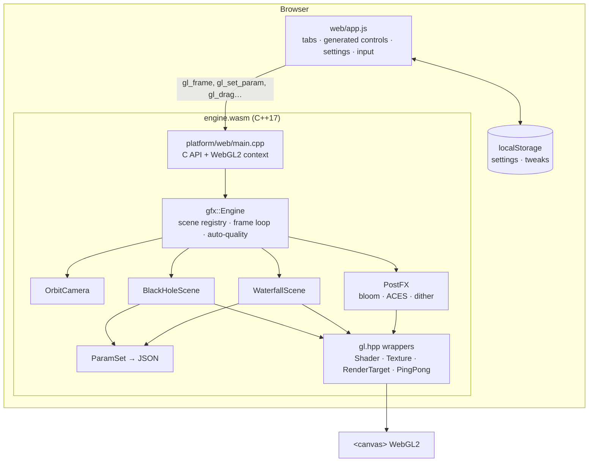

# System design

## Overview

Graphics Library is a small C++17 rendering engine plus simulations. It is compiled to WebAssembly with Emscripten and renders through WebGL2 (OpenGL ES 3.0). The web page is a thin shell. It owns the `requestAnimationFrame` loop and the UI, and talks to the engine through a C API. There is no backend: the site is static files on GitHub Pages.

## Components

| Component | Job |
|---|---|
| `gfx/math.hpp` | Vectors and column-major `mat4` (perspective, lookAt). Header-only and GL-free. |
| `gfx/params.hpp` | Each scene's tweakable values: sliders, toggles and choices with ranges, units, groups and help text. It clamps input and serialises to JSON for the UI. |
| `gfx/blackbody.hpp` | Planck spectrum × CIE 1931 colour-matching functions (Wyman et al. 2013 fit) → linear sRGB at unit luminance. Used for disk and star colours. |
| `gfx/gl.hpp` | RAII wrappers: shader compile and link (errors are captured for the UI), textures, multi-attachment render targets, ping-pong pairs, and an attribute-free fullscreen triangle. |
| `gfx/camera.hpp` | Orbit camera with exponential easing; auto-orbit. |
| `gfx/scene.hpp` | The interface a simulation implements (`init`, `setupCamera`, `update`, `render`, `reset`, `params`). |
| `gfx/postfx.hpp` | HDR → display. A 13-tap progressive downsample with a Karis average on the first level, a tent-filtered upsample, ACES (Narkowicz fit), sRGB encoding and ±½ LSB dither. |
| `gfx/engine.hpp` | Owns the scenes, lazy init, the HDR target (RGBA16F + 24-bit depth), frame-time smoothing and auto-resolution. |
| `platform/web/main.cpp` | Creates the WebGL2 context, enables `EXT_color_buffer_float`, registers the scenes, and exports `gl_*` functions. |
| `web/app.js` | Builds the tabs and controls from engine JSON. Handles pointer, wheel and pinch input, keyboard shortcuts, settings and storage, and the frame loop. |

## Main flows

**Startup.** `createEngine()` loads the wasm, then `gl_init("#canvas")` creates the context and checks float render targets. If either fails, the page shows a plain message instead of a blank canvas. Then JS reads `gl_scenes()`, picks the scene from the URL hash or the last one used, and starts the loop.

**Selecting a scene.** `gl_select(i)` initialises the scene the first time (lazy, so the waterfall's GPU memory isn't allocated until you open it) and resets the camera. JS replays this viewer's saved tweaks with `gl_set_param`, then builds the controls from `gl_params()`.

**A frame.** JS sizes the canvas (CSS size × capped DPR) and calls `gl_frame(dt, w, h)`. The engine then:

1. Smooths the frame time and nudges the render scale.
2. Resizes the HDR target if needed.
3. Eases the camera.
4. Calls `scene.update`.
5. Binds the HDR target, clears it, and calls `scene.render`.
6. Runs PostFX to the canvas.

`dt` is clamped to 50 ms, so a background tab doesn't cause a huge simulation step.

**Black Hole render.** One fullscreen pass. Each pixel integrates a null geodesic with RK4 (see Physics). The step size is proportional to r. The ray stops on reaching the horizon (r < 2M), on escaping outward past the escape radius, or after the quality-dependent step limit (200, 360 or 700). Each disk-plane crossing composites blackbody emission front-to-back. An escaped ray samples the procedural sky in its final direction.

**Waterfall update and render.** Particle state lives in two RGBA32F textures: position + life, and velocity + type. A fragment shader with two outputs steps every particle at a fixed 1/120 s, ping-ponging between texture pairs, with up to 4 steps per frame. A new state first runs 4 s of warm-up spread over a few frames, so the fall is already flowing. Render is two passes:

1. A ray-marched environment (cliff, ledge, boulders, pool with Fresnel reflection, sky). It writes `gl_FragDepth`.
2. All particles as point sprites, fetched with `texelFetch(gl_VertexID)` and blended with premultiplied alpha, depth-tested but not depth-written.

## Physics

### Black Hole (geometric units G = c = M = 1)

- **Geodesics.** The Schwarzschild orbit equation u″ + u = 3Mu² is reproduced exactly by the Cartesian acceleration a = −3Mh²x/r⁵, where h = |x × v| is conserved (Chandrasekhar 1983). Only the path is physical; the integration parameter is not a physical time.
- **Disk.** Thin and equatorial, from r_in (default 6M, the ISCO) to r_out. Flux F ∝ r⁻³(1 − √(r_in/r)) (Shakura & Sunyaev 1973), so T ∝ F^¼, which peaks at 49/36 r_in.
- **Shifts.** g = √(1 − 3M/r) / (1 − Ωλ), with Ω = r^−3/2 and λ the photon's L_y/E (Cunningham 1975; Luminet 1979). The observed spectrum is a blackbody at gT, drawn with intensity ∝ (gT)⁴, because I_ν/ν³ is invariant.
- **Modes.**
  - *General relativity*: lensing plus shifts.
  - *Lensing only*: g = 1.
  - *Newtonian*: straight rays, which shows what the lensing does.

### Waterfall (SI units)

- a = g − k|v − w|(v − w), with g = 9.81 m/s², k = g/v_t², and w the wind. The default v_t = 9 m/s matches a 2 mm raindrop (Gunn & Kinzer 1949). Semi-implicit Euler at 120 Hz.
- Rock is one signed-distance function, used by both the physics and the renderer. The renderer adds up to about 0.15 m of surface relief that the physics ignores.
- Collision projects the particle out along the SDF gradient. Restitution is 0.15 on the normal component. Tangential friction scales with impact speed: none below 0.5 m/s, full (30%) at 2 m/s. This keeps resting water sliding instead of sticking to ledges.
- Types: water → spray (on a rock impact faster than 2.5 m/s, with the *Splash* probability), and water → mist or spray at the pool. Mist has heavy drag (v_t 0.6 m/s), near-zero gravity and a decorative swirl.

### Estimates and artistic choices (labelled in the UI too)

- **Black hole.** Disk temperature is scaled into visible light; real disks peak near 10⁷ K in X-rays. The gas texture is decorative noise sheared by Keplerian rotation, with two phases cross-faded so it never winds up. The camera is treated as an observer at infinity: no local aberration and no √(1 − 2M/r) factor at the camera, about 3% off at 34M. Stars and the galactic band are procedural, not a catalogue.
- **Waterfall.** Restitution, friction, the splash and mist probabilities, mist drag and the swirl were tuned by eye. Sun colour versus height is art-directed, not a sky model.

## Where data lives

There is no server-side data. The browser's `localStorage` holds:

- `gl.settings`: quality, resolution, auto-resolution, DPR cap, theme, FPS display.
- `gl.scene`: the last simulation used.
- `gl.params.<id>`: this viewer's slider values per simulation.
- `gl.collapsed`: which control groups are folded.

Every access is wrapped in try/catch. With storage blocked, the page works and simply forgets.

## Key decisions and trade-offs

| Decision | Why | Cost |
|---|---|---|
| C++ → WASM + WebGL2 (not WebGPU) | Runs in every current browser, including Safari 15+. The same C++ builds natively for tests. | No compute shaders, so particles are simulated in fragment shaders with float render targets. |
| JS owns the frame loop | Pausing, visibility and resizing stay simple. There is no `emscripten_set_main_loop` state. | One wasm call per frame (negligible). |
| UI generated from `ParamSet` JSON | A new simulation gets controls with no JS changes. | Controls are generic sliders, toggles and choices. |
| CPU reference copies of the physics | The equations can be unit-tested without a GPU. | The GLSL is a hand-mirrored copy, so changes must touch both. Comments point at each other. |
| Fixed 120 Hz waterfall step, at most 4 per frame | Deterministic and stable. | On slow frames the simulation runs slower than real time instead of exploding. |
| Lazy scene init | Opening the black hole never allocates the waterfall's particle state (about 17 MB at Medium, 34 MB at High). | First switch to a scene compiles its shaders (about 100 ms). |
| Auto-resolution in small steps | Holds the frame rate on weak GPUs without visible jumps. | Brief softness while it adapts. |
| Static site, feedback via prefilled GitHub issue | No backend, no cost, no data collected. | Feedback needs a GitHub account. |

## Testing

`tests/tests.cpp` (native, `./scripts/build.sh` or CI) checks:

- **Math.** lookAt and perspective map points where expected.
- **Parameters.** Clamping, snapping, rounding, NaN and unknown-id rejection, reset, JSON shape.
- **Blackbody.** ~6500 K is near white, 3000 K is orange, 20000 K is blue-white.
- **Black hole.**
  - Capture at b = 3√3M − 0.05 and escape at +0.05.
  - Weak-field deflection matches 4M/b + 15πM²/4b² within 2% at b = 100M.
  - A circular photon orbit at 3M stays within 0.001M.
  - Flux peaks at 49/36 r_in, with no emission inside r_in.
  - Transverse redshift at the ISCO is 1/√2, and the approaching and receding sides shift the right way.
- **Waterfall.**
  - Free fall from 12 m takes √(2h/g).
  - Terminal speed is reached under drag.
  - A collision resolves penetration and kills inward velocity.
  - Sliding contact keeps its speed.

**Manual review checklist** (what tests can't see):

- [ ] Both scenes render in Chrome, Safari and Firefox on macOS, and in Safari on iOS.
- [ ] The black hole's approaching side (left at the default view) is brighter and bluer. Newtonian mode removes the lensed arc over the top.
- [ ] The waterfall splits on the ledge, spray leaves the boulders, and mist drifts with the wind.
- [ ] Light and dark themes: all controls, the dialog and the tag chips are readable.
- [ ] Phone width (375 px): no horizontal scroll, and pinch zoom works.
- [ ] Quality Low holds about 60 fps on integrated graphics, and auto-resolution kicks in on slow GPUs.
- [ ] Blocked storage (private window): the page still runs.

## Known limits

- Non-spinning (Schwarzschild) only. No Kerr frame dragging, no disk self-occlusion thickness, no relativistic beaming of the background.
- The flux is the Newtonian profile, not Page–Thorne.
- The waterfall is ballistic particles, not Navier–Stokes. There is no pressure, surface tension, cohesion or two-way coupling with the pool, and the pool surface is a plane with procedural ripples.
- The waterfall needs `EXT_color_buffer_float` (RGBA32F render targets). Very old mobile GPUs show an error message instead.
- Particles blend unsorted. This is fine for similar-coloured water but would show artifacts with strongly varied colours.
